

  

<!-- tools:start -->
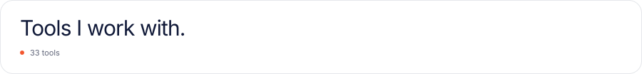

  
  
  <a href="https://en.wikipedia.org/wiki/SQL">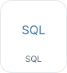</a>
  <a href="https://dev.java">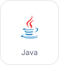</a>
  <a href="https://isocpp.org">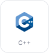</a>
  <a href="https://learn.microsoft.com/dotnet/csharp/">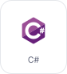</a>
  
  <a href="https://www.mathworks.com/products/matlab.html">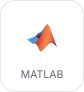</a>

  
  <a href="https://scikit-learn.org">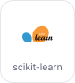</a>
  
  
  
  <a href="https://ollama.com">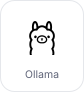</a>
  
  <a href="https://numpy.org">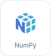</a>

  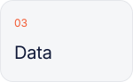
  <a href="https://www.getdbt.com">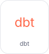</a>
  
  
  
  

  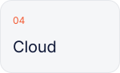
  
  
  

  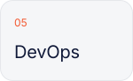
  
  <a href="https://www.terraform.io">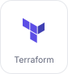</a>
  <a href="https://git-scm.com">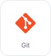</a>
  
  
  

  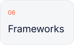
  <a href="https://flask.palletsprojects.com">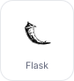</a>
  <a href="https://spring.io/projects/spring-boot">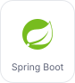</a>
  
  <a href="https://www.latex-project.org">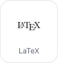</a>
  

<!-- tools:end -->

  

  
  

  
  

 

